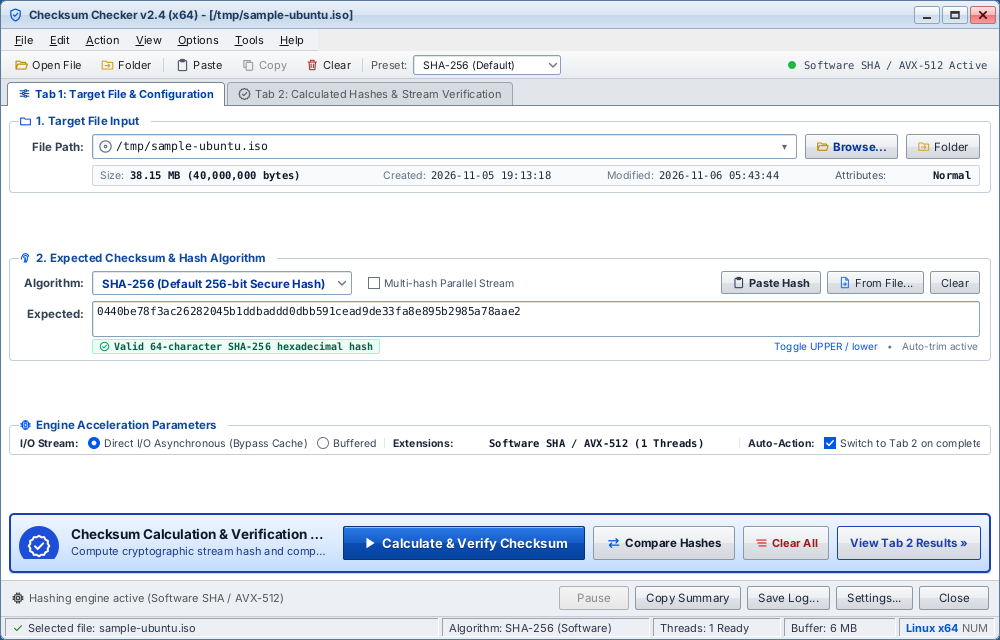
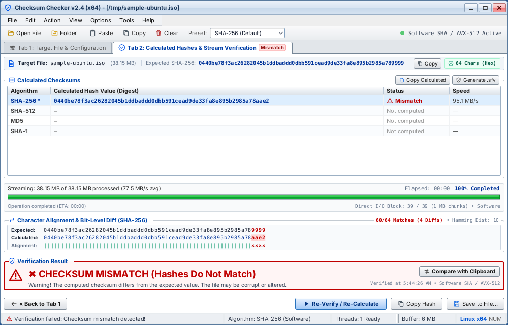

# Checksum Checker/Validator - File Hash Checksum Validator

## Summary

**Checksum Checker/Validator** is a desktop utility that calculates the hash of any file and validates it against a checksum you provide, so you can confirm that a download is complete and untampered. It wears a glossy Windows Vista/7 Aero look and is built in Java.

## Development Status

#### Note : Vibe Coded, In-Development - Bugs may exist - Use with caution - Report Bugs and Feature Requirements!!!

  

---

## ❤️ Support This Project

If you enjoy using this software, you can support
its continued development!

### 🍕 Buy Me a Pizza  
<a href="https://buymeacoffee.com/sahasrarachakra?l=en">
  
</a>


## If you are an Indian Supporter
### 🇮🇳 Support via UPI

Scan this QR code using Google Pay, PhonePe or Paytm.


Thank you for supporting open-source development!

---

## Screens







## Features

- Calculate file hashes (such as MD5, SHA-1, SHA-256, SHA-384 and SHA-512)
- Validate a file against a pasted or loaded checksum with a clear match / mismatch result
- Two-tab interface with a shared menu, toolbar and status bar
- Windows Vista/7 Aero glossy look with custom title bar and buttons
- Product Sans / Open Sans interface font and JetBrains Mono for hash values
- Fixed 1000 x 640 startup size, fully resizable
- Works fully offline

## Prerequisites for Running

- Windows (best look), Linux or macOS
- **Java 26** (JRE or JDK) - check with `java -version`

## How to Run

1. Download the latest release (`ChecksumChecker.jar`) from the **Releases** page of this repository.
2. Make sure Java 26 or later is installed (`java -version`).
3. Double-click the `.jar` file, **or** run it from a terminal:

```bash
java -jar ChecksumChecker.jar
```

> On Windows you can also create a shortcut to `javaw -jar ChecksumChecker.jar` to start it without a console window.

## How to Use

1. On the first tab, click **Browse** (or drag in a file) to select the file to check.
2. Choose the hash algorithm(s) and click **Calculate**. Copy the result with the copy button.
3. To validate, go to the second tab, select the file, paste the checksum published by the source and click **Verify**.
4. The result panel shows whether the checksum **matches** or **does not match**.

## Keyboard Shortcuts

| Shortcut | Action |
|---|---|
| `Ctrl + O` | Open / browse for a file |
| `Ctrl + 1` / `Ctrl + 2` | Switch to Calculate / Verify tab |
| `Ctrl + Enter` | Calculate / Verify |
| `Ctrl + C` | Copy selected hash |
| `Ctrl + Q` | Exit |

<!-- Verify this table against the shortcuts actually implemented in your build. -->

## Prerequisites for Building

- **JDK 26**
- Fonts: Product Sans / Open Sans and JetBrains Mono (TTF files in `resources/fonts/`)
- An IDE (NetBeans / IntelliJ IDEA / VSCodium) or the command line
- Git

## How to Build

1. Clone the repository:

```bash
git clone https://github.com/<your-username>/<repository-name>.git
cd <repository-name>
```

2. **Using an IDE:** open the project in NetBeans (or IntelliJ IDEA / VSCodium with Java extensions), make sure the project JDK is 26+, add the libraries from the `lib/` folder to the classpath, then choose **Run / Build**.

3. **Using the command line:**

```bash
# Windows (use ':' instead of ';' on Linux/macOS)
mkdir out
javac -cp "lib/*" -d out -sourcepath src src/com/jsoft/checksum/Main.java
jar cfe ChecksumChecker.jar Main -C out .
```

> Adjust the main class and paths above to match your project layout. Copy any resource folders (fonts, images, `.properties` themes) into the output before packaging, if your IDE does not do this automatically.

## Copyright

© JSoft Bharath, Kerala, India & Jeevan Kumar Vishwakarman. All rights reserved.

**Checksum Checker/Validator - File Hash Checksum Validator Developed By : JSoft Bharath, Kerala, India. / Jeevan Kumar Vishwakarman. All Rights Reserved To : JSoft Bharath, Kerala, India. / Jeevan Kumar Vishwakarman.**

## License

**Attribution-Required, No-Modification, No-Resale License**

Copyright © JSoft Bharath, Kerala, India & Jeevan Kumar Vishwakarman ("the Authors").

Permission is hereby granted, free of charge, to any person or organization obtaining a copy of this software and its source code ("the Software") to **use** the Software, for personal or commercial purposes, subject to the following conditions:

1. **Attribution is compulsory.** Any use of the Software, in any application, product, service, documentation or website, must display the following attribution text, in bold, in a place reasonably visible to users (for example an About dialog, credits screen, README or product page):

   **Checksum Checker/Validator - File Hash Checksum Validator Developed By : JSoft Bharath, Kerala, India. / Jeevan Kumar Vishwakarman. All Rights Reserved To : JSoft Bharath, Kerala, India. / Jeevan Kumar Vishwakarman.**

2. **No modification.** You may not change, modify, adapt, translate, decompile, reverse-engineer or create derivative works of the Software's code or binaries. The Software must be used exactly as distributed by the Authors.

3. **No selling or charging for the Software.** You may not sell, rent, sublicense, or charge any fee for the Software or its code, in whole or in part, or bundle it in a way that charges for the Software itself. You **may** charge for your own applications, products and services that use the Software, provided the Software itself is not what is being sold and condition 1 is met.

4. **Redistribution.** You may redistribute the unmodified Software free of charge only if this license, the copyright notice and the attribution text are kept intact.

5. **Ownership.** The Software is licensed, not sold. All rights not expressly granted are reserved by the Authors.

6. **Termination.** Any breach of these terms automatically terminates your rights under this license.

THE SOFTWARE IS PROVIDED "AS IS", WITHOUT WARRANTY OF ANY KIND, EXPRESS OR IMPLIED, INCLUDING BUT NOT LIMITED TO THE WARRANTIES OF MERCHANTABILITY, FITNESS FOR A PARTICULAR PURPOSE AND NONINFRINGEMENT. IN NO EVENT SHALL THE AUTHORS BE LIABLE FOR ANY CLAIM, DAMAGES OR OTHER LIABILITY, WHETHER IN AN ACTION OF CONTRACT, TORT OR OTHERWISE, ARISING FROM, OUT OF OR IN CONNECTION WITH THE SOFTWARE OR THE USE OR OTHER DEALINGS IN THE SOFTWARE.

For permission requests beyond these terms, contact the Authors via the repository's Issues page.
